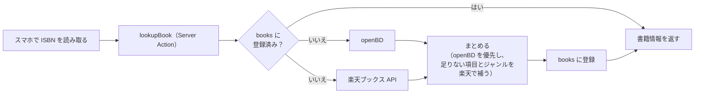

# MineBook とは？

古本屋で見つけた本を、スマホでスキャンして記録し、PC の本棚に並べて楽しむ Web アプリです。

例えば、古本屋の棚で気になる本を見つけたら、裏表紙のバーコードをスマホで読み取る。書名や定価が自動で出てくるので、店頭価格を入れると「お宝度」が S / A / B で分かります。買った本はコレクションに残り、家に帰ってから PC で眺められます。

- 公開 URL：https://trident-minebook.vercel.app/
- キャッチコピー：古本との出会いを、持ち帰れる本棚へ。

## 試し方

ログインが必要です。新規登録（メールアドレスとパスワード）か、Google アカウントで入れます。

1. 公開 URL を開き、新規登録またはログインする
2. スマホでは「ホーム」、PC・タブレットでは「ダッシュボード」が開く
3. スマホの「ISBN スキャン」タブで、裏表紙のバーコードの**上段（978〜）**を枠に合わせる。読み取れると、書名・著者・書影が下の「読取済みリスト」に追加される
4. カメラが使えないときは、ISBN の手入力欄か「テスト用」のボタンでも追加できる
5. リストの本を開き、店頭価格を入れて「判定する！」を押すと、お宝度（S / A / B）が出る
6. 「購入（レジへ）」「保留（棚に戻した）」「見送り（今回はパス）」を選ぶと、自分のコレクションに保存される

カメラは https のページでしか使えません。公開 URL ならそのまま使えます。

## しくみ

### お宝度の判定

定価からどれだけ安いか（割引率）で決めます。いまの判定ルールは仮のもので、正式なルールは調整中です。

| ランク | 条件 |
|---|---|
| S | 定価から 75% 以上安い、または定価が分からない |
| A | 定価から 50% 以上安い |
| B | それ以外 |

判定は [src/app/(mobile)/_data/rank.ts](src/app/(mobile)/_data/rank.ts) の `calcRank` 1 か所にまとめています。スマホのどの画面からも、ここを呼んでいます。

### バーコードの読み取り

本の裏表紙にはバーコードが 2 段あります。上段が ISBN（978 / 979 で始まる 13 桁）、下段は価格などのコード（192 で始まる）です。

| 工夫 | 中身 |
|---|---|
| 上段だけを読む | 978 / 979 で始まり、チェックディジットが合うものだけを ISBN として扱う。下段は無視する |
| 二重に追加しない | 同じ本を映し続けている間は 1 回だけ追加する。3 秒以上映らなかった後にもう一度映すと、また読み取る |
| 端末に合わせて読み取り方を変える | Android の Chrome などはブラウザ内蔵の `BarcodeDetector` を使う。iPhone の Safari には内蔵機能がないので、ライブラリ（zxing の wasm 版）で読み取る |
| ライト | ライトを操作できる端末だけにボタンを出す（iPhone の Safari は非対応） |

コードは [src/app/(mobile)/_components/scan/](src/app/(mobile)/_components/scan/) の `useBarcodeScanner.ts` と `CameraPreview.tsx` にあります。

### 書籍情報の取得



- はじめて読み取った本だけ、サーバーが外部 API から取得して `books`（書籍マスター）に登録します。2 回目からは `books` から返すので速くなります
- openBD と楽天ブックス API は同時に呼びます。片方が落ちていても、もう片方で書名が取れれば登録します
- カテゴリーは、楽天ブックスのジャンルから自動で決めます。決められない本は「未分類」になります
- 楽天ブックス API のキーがなくても動きます。その場合、カテゴリーは未分類になり、openBD にない本は登録できません

### データの守り方

- データの読み書きは Supabase の RLS（行レベルセキュリティ）で守っています。自分のコレクション・本棚・タグは、自分しか読み書きできません
- `books`（書籍マスター）は、ブラウザからは書き込めません。サーバーだけが書き込みます
- 画面の表示・非表示はセキュリティではありません。データの保護は Server Action と RLS で行っています
- ログインが必要なページは [src/proxy.ts](src/proxy.ts) で、未ログインなら `/login` に移動させます

## いまの状態

- [x] ログイン・新規登録（メール + パスワード、Google）
- [x] 端末による振り分け（スマホは `/home`、PC・タブレットは `/dashboard`）
- [x] スマホ：ISBN から書籍情報を取得（openBD・楽天ブックス）
- [x] スマホ：カメラでバーコードを読み取る
- [x] スマホ：店頭価格からお宝度を判定する
- [x] スマホ：購入・保留・見送りを選んで、コレクションに保存する
- [x] スマホ：ホームで価格の判定と購入・保留・見送りを変えると、コレクションに保存する
- [x] サーバー側の関数（コレクション・本棚・タグの取得と更新）
- [x] カメラの読み取りを、実機（iPhone・Android）で確認する
- [x] スマホ：ホームの一覧を、保存したコレクションにつなぐ
- [ ] PC：ダッシュボード・本棚・コレクション・ランキング・履歴・分析を DB につなぐ（画面はできている。いまは仮データ）
- [ ] お宝度の正式な判定ルールを決める

## 技術スタック

| 用途 | 使用技術 |
|---|---|
| フレームワーク | Next.js 16（App Router、Cache Components 有効） |
| 言語 | TypeScript |
| スタイル | Tailwind CSS v4 |
| アイコン | lucide-react |
| 認証 | Supabase Auth（メール + パスワード、Google） |
| DB | Supabase（PostgreSQL + RLS）。スキーマは Supabase CLI のマイグレーションで管理 |
| 書籍情報 | openBD、楽天ブックス API |
| バーコード | BarcodeDetector API、barcode-detector（zxing-wasm） |
| 本棚の並び順 | fractional-indexing（並べ替えても他の本の位置を書き換えない） |
| 入力チェック | zod |
| パッケージ管理 | pnpm |
| CI | GitHub Actions（lint・ビルド・型チェック） |
| ホスティング | Vercel |

## 動かし方

Node.js 24 で確認しています（[.node-version](.node-version)）。pnpm は Corepack で入れます。

```bash
corepack enable
pnpm install
```

`.env.local` を作り、次の値を入れます。

| 変数 | 必須 | 中身 |
|---|---|---|
| `NEXT_PUBLIC_SUPABASE_URL` | 必須 | Supabase の Project URL |
| `NEXT_PUBLIC_SUPABASE_ANON_KEY` | 必須 | Publishable key（または旧形式の anon key） |
| `SUPABASE_SECRET_KEY` | 必須 | Secret key。`books` の登録に使う。サーバー専用なので `NEXT_PUBLIC_` を付けない |
| `RAKUTEN_APPLICATION_ID` | 任意 | 楽天ウェブサービスのアプリ ID |
| `RAKUTEN_ACCESS_KEY` | 任意 | 楽天ウェブサービスのアクセスキー |
| `RAKUTEN_REFERER` | 任意 | 楽天のアプリ設定に登録した Web サイト URL。localhost で動かすときも、登録済みの URL（本番の URL）を入れる |

```bash
pnpm dev
```

| コマンド | 内容 |
|---|---|
| `pnpm dev` | 開発サーバーを起動 |
| `pnpm build` | 本番ビルド |
| `pnpm start` | ビルドしたものを起動 |
| `pnpm lint` | コード解析 |
| `pnpm typecheck` | 型チェック |
| `pnpm db:new <名前>` | マイグレーションのファイルを作る |
| `pnpm db:push` | 未適用のマイグレーションを反映する |
| `pnpm db:pull` | リモートのスキーマを取り込む |
| `pnpm db:types` | `src/types/database.ts` を作り直す |

### 開発で気をつけること

- **スマホでカメラを試すときは https が必要です。** スマホから `http://<Mac の IP>:3000` で開くとカメラは使えません。Vercel のプレビュー URL で試してください
- **Google ログインの戻り先は、Supabase の Redirect URLs に登録が必要です。** 登録していない URL から始めると、ログイン後に本番の URL に戻されます
- **スキーマの変更はダッシュボードで直接行わず、マイグレーションで管理します。** 初回だけ `pnpm exec supabase login` と `pnpm exec supabase link` が必要です
- **Next.js 16 は、古い記事や学習データと仕様が違います。** 迷ったら `node_modules/next/dist/docs/` を読みます

## 認証の使い方

フロントエンド（PC・スマホ）からは、次を使います。

| 用途 | import |
|---|---|
| ログイン / 登録 / ログアウト（`useActionState` 対応） | `signIn` / `signUp` / `signOut` from `@/features/auth/actions` |
| Google でログイン・登録（`<form action>` に渡す） | `signInWithGoogle` from `@/features/auth/actions` |
| Google ログインのボタン | `GoogleSignInButton` from `@/features/auth/components/GoogleSignInButton` |
| ログアウトのボタン | `SignOutButton` from `@/features/auth/components/SignOutButton` |
| フォーム状態の型 | `AuthFormState` from `@/features/auth/types` |
| Server Component でユーザー取得 | `getCurrentUser` / `requireUser` from `@/features/auth/dal` |
| Client Component から Supabase | `createClient` from `@/lib/supabase/client` |

- フォームの name 属性：`email` / `password` / `displayName`（登録のみ）/ `next`（ログインのみ・hidden）
- Google ログインはブラウザから Supabase を直接呼ばず、必ず `signInWithGoogle` を使います。フォームに `next`（hidden）を入れると、ログイン後にそのページへ戻ります
- LINE・Instagram などのアプリ内ブラウザでは、Google ログインが使えません（Google の制限）。メール + パスワードも残しておきます
- `/login` のエラー表示：`?error=confirm_failed`（メール確認・Google ログインの失敗）/ `?error=oauth_failed`（Google ログインを開始できなかった）

書籍・コレクション・本棚・タグの関数は [src/app/README.md](src/app/README.md) の「よく使う import」にまとめています。

## ディレクトリ構成

```
src/
  app/
    (auth)/          ログイン・新規登録
    (mobile)/        スマホの画面（ホーム・ISBN スキャン）
    (dashboard)/     PC の画面（ダッシュボード・本棚・コレクション・ランキング・履歴・分析）
    books/[isbn]/    書籍詳細
    auth/confirm/    確認メールと Google ログインの戻り先
  components/        画面をまたいで使う部品（common / ui）。画面専用の部品は各画面の _components/ に置く
  features/
    auth/            ログイン・登録・ログアウト、ログインユーザーの取得
    books/           ISBN から書籍情報を取得して books に登録
    collection/      自分のコレクションの取得・登録・更新・削除
    shelves/         本棚の作成・並べ替え・本の配置
    tags/            タグの作成・本へのタグ付け
  lib/
    openbd/          openBD API
    rakuten/         楽天ブックス API
    supabase/        Supabase のクライアント（サーバー用・ブラウザ用）
    utils/           ISBN の正規化など
  types/database.ts  DB の型（pnpm db:types で生成）
  proxy.ts           ログインが必要なページの保護と、端末による振り分け
supabase/migrations/ DB のマイグレーション
docs/                要件・DB・API の資料、議事録（requests/ はメンバーへの依頼メモで、Git には入れない）
```

画面（`src/app/`）の書き方・担当・ルールは [src/app/README.md](src/app/README.md) に書いています。

## ドキュメント

- [src/app/README.md](src/app/README.md)：画面の仕様・担当・書き方
- [CONTRIBUTING.md](CONTRIBUTING.md)：ブランチと Pull Request のルール
- [docs/requirements.md](docs/requirements.md)：要件定義
- [docs/database.md](docs/database.md)：DB の設計
- [docs/api.md](docs/api.md)：API
- [docs/meeting-log.md](docs/meeting-log.md)：議事録
