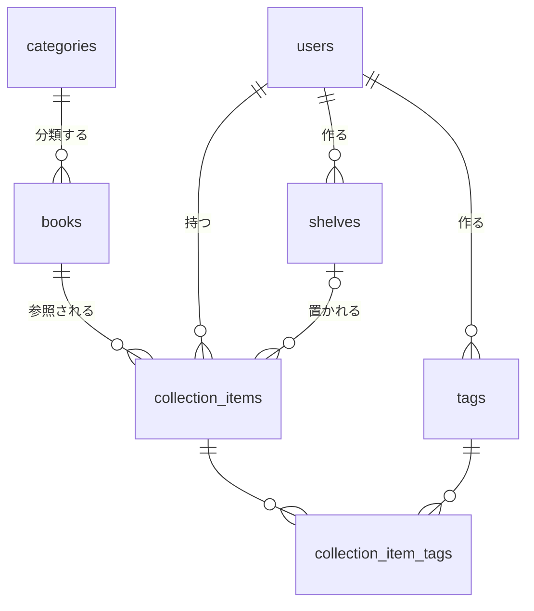

# DB 設計

Supabase（PostgreSQL）を使います。スキーマは `supabase/migrations/` のマイグレーションで管理し、ダッシュボードでは直接変更しません。

- 型は `pnpm db:types` で [src/types/database.ts](../src/types/database.ts) に生成します。コードからは `Tables<"books">` のように使います
- この資料は要点だけです。正確な定義はマイグレーションを見てください

## テーブルの関係

## テーブル

### books（書籍マスター）

全ユーザーで共有します。ブラウザからは書き込めず、サーバーが外部 API（openBD・楽天ブックス）から取った内容を secret key で登録します。

列名 | 型 | 説明
---|---|---
isbn | text | PK。ハイフンなしの ISBN-13（978 / 979 で始まる 13 桁）
title | text | 書名（必須）
author | text | 著者
publisher | text | 出版社
description | text | あらすじ
cover_url | text | 書影の URL
list_price | integer | 定価
category | text | カテゴリー（FK → categories.slug）。決められない本は null（画面では「未分類」）
rakuten_genre_id | text | 楽天ブックスのジャンル ID（カテゴリーを決めるのに使う）
review_average | numeric(3,2) | 楽天ブックスのレビュー平均（0〜5）。レビューが 0 件なら null
review_count | integer | 楽天ブックスのレビュー件数（0 以上）
created_at | timestamptz | 作成日時
updated_at | timestamptz | 更新日時（更新時にトリガーで自動更新）

### categories（カテゴリー）

本の分類です。絞り込みとランキングに使います。

列名 | 型 | 説明
---|---|---
slug | text | PK（`novel`・`comic` など英小文字）
name | text | 表示名
sort_order | integer | 表示順
created_at | timestamptz | 作成日時

登録済みの 12 件：小説・文学 / ライトノベル / 漫画 / 絵本・児童書 / ビジネス・経済 / パソコン・IT / 科学・技術・医学 / 人文・思想・社会 / 趣味・スポーツ・芸術 / 暮らし・健康・旅行 / 語学・学習・資格 / その他

### users（ユーザー）

Supabase Auth の `auth.users` に 1 対 1 で対応します。登録時にトリガーで自動作成されます。

列名 | 型 | 説明
---|---|---
id | uuid | PK（= auth.users.id。ユーザーを消すと一緒に消える）
display_name | text | 表示名（30 文字まで）。メール登録の名前、なければ Google の名前
avatar_url | text | アイコンの URL
created_at | timestamptz | 作成日時

### collection_items（コレクション）

ユーザーがスキャンして保存した本です。1 回のスキャンが 1 行になります。

列名 | 型 | 説明
---|---|---
id | uuid | PK
user_id | uuid | 持ち主（FK → users）
isbn | text | 本（FK → books）
store_price | integer | 店頭価格。お宝度（S / A / B）は定価とこの値から画面側で計算する
store_name | text | 店の名前
status | text | `purchased`（購入）/ `pending`（保留）/ `skip`（見送り）。未選択は null
shelf_id | uuid | 置いた本棚（FK → shelves）。本棚を消すと null（未配置）に戻る
shelf_position | text | 棚の中の並び順（fractional-indexing のキー）。shelf_id があるときだけ入る
treasure_score | integer | お宝度のスコア（いまは使っていない）
purchase_date | date | 購入日
notes | text | メモ
scanned_at | timestamptz | スキャン日時
created_at | timestamptz | 作成日時

### shelves（本棚）

列名 | 型 | 説明
---|---|---
id | uuid | PK
user_id | uuid | 持ち主（FK → users）
name | text | 本棚の名前（同じユーザーの中で重複不可）
created_at | timestamptz | 作成日時

### tags（タグ）

列名 | 型 | 説明
---|---|---
id | uuid | PK
user_id | uuid | 持ち主（FK → users）
name | text | タグ名（同じユーザーの中で重複不可）
color | text | 表示色
created_at | timestamptz | 作成日時

### collection_item_tags（本とタグの多対多）

列名 | 型 | 説明
---|---|---
collection_item_id | uuid | FK → collection_items（PK の一部）
tag_id | uuid | FK → tags（PK の一部）
created_at | timestamptz | 作成日時

## アクセス制御（RLS）

テーブル | 読む | 書く
---|---|---
books・categories | 誰でも | サーバーのみ（secret key）
users | 本人のみ | 本人のみ（更新）
collection_items・shelves・tags | 本人のみ | 本人のみ。collection_items は他人の本棚を指定できない
collection_item_tags | 自分の本の分だけ | 自分の本に自分のタグだけ付け外しできる

画面での表示・非表示はセキュリティではありません。データは RLS と Server Action で守っています。
